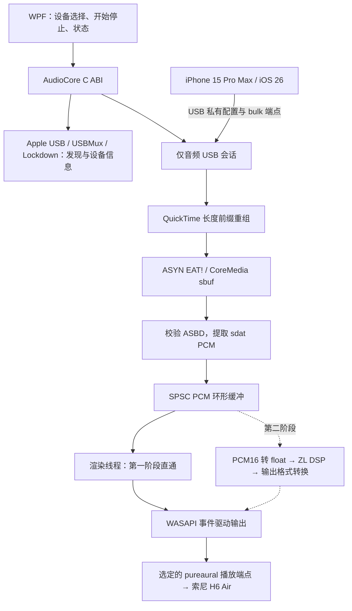

> 2026-09-24 路线更新：第二阶段改为保留 ZL 原版界面的自定义 JUCE Standalone，接入现有 USB/WASAPI 后端。

> 历史记录：WPF 前端及其发布脚本现已移除；下文保留当时的设计或验收依据。当前入口见 [README](../README.md)。
> 以 [ZL Standalone 集成设计](zl-standalone-usb-integration-plan.zh-CN.md)为后续实施依据。
> 下文保留最初分析及第一阶段依据，其中“第二阶段仅调用 DSP 子集、WPF 重做界面”的安排已被新方案取代。

本报告确定第一阶段的实现依据：以用户已经验证成功的 iPhoneMirror USB 仅音频分支为接收端基线，抽取独立的 C++ AudioCore，通过 .NET 8 WPF 控制。第一阶段不集成压缩器，原定第二阶段直接调用 ZLCompressor 的 DSP 子集。

分析日期：2026-09-24。目标设备：iPhone 15 Pro Max / iOS 26；Windows 11；原道 pureaural 搭配索尼 H6 Air；第一阶段关闭游戏麦克风。DAC 支持的实际 WASAPI 格式和周期由运行时查询，不根据型号推断。

**基线与验证范围。** 已检查以下源码与历史记录，本轮没有重新编译或连接手机执行采集。

| 来源 | 固定版本或位置 | 用途 |
|---|---|---|
| 已验证的 USB 仅音频分支 | `D:/GreenSoftware/iPhoneMirror-v1.8.3-win-x64/audio-only-source`；基于 `1270c443a29457751cadd20f6d7bbe1ce213b9db`，另有未提交修改及新增文件 | MVP 的主要移植基线；只记录 commit 不足以复现，必须保留工作区修改 |
| iPhoneMirror 上游 | `0e26a3f6b5079001d8920e552c329b2e6c97013e` | 对照协议、USB 和播放实现，选择性吸收修复 |
| ZLCompressor 上游 | `0e19ffcf3dcf7304ca2f650cd28267959bd40a21` | 分析可独立调用的压缩算法 |

本地 [USB 仅音频说明](D:/GreenSoftware/iPhoneMirror-v1.8.3-win-x64/audio-only-source/docs/USB_AUDIO_ONLY.md) 与 [验证记录](D:/GreenSoftware/iPhoneMirror-v1.8.3-win-x64/UsbAudioOnly/验证记录.md) 均已核对。对应日志的最后一次成功会话确认：约 150 秒，7021 个音频包，0 个视频包，0 字节视频 payload；48 kHz、16 bit、双声道；WASAPI 输出 7,185,696 帧，underruns=0，启动时丢弃 32 帧。此证据支持目标手机上的真正 USB 仅音频传输，不只是关闭预览。

停止过程也需要准确保留：手机返回 SYNC STOP，但没有返回预期的 RELS；等待约 6 秒后进入 USB 恢复流程，约 20 秒后确认正常配置。它已经成功恢复，但尚不是快速退出。已有记录没有证明 PUBG 长时间运行、暂停恢复和拔线重连都已通过。

**1. 音频数据流及连接流程。** 控制通道和 PCM 通道是两条不同的路径。



音频数据始终留在 Native 层。P/Invoke 仅传递配置、命令和状态，WPF 不按音频块搬运 PCM。

实际连接顺序来自本地已验证的 [QuickTimeSession.cpp](D:/GreenSoftware/iPhoneMirror-v1.8.3-win-x64/audio-only-source/src/Core/src/Protocol/QuickTimeSession.cpp:235)：

1. 用 Apple 官方服务的 USBMux 枚举及 Windows PnP 信息确认目标设备、连接状态和驱动状态。Lockdown 用于名称、系统版本及可访问性判断；存在配对记录不等于当前已完成信任验证。
2. 通过既有 libusb0 路径启用私有采集配置：vendor request `0x40/0x52`、`wValue=0`、`wIndex=2`。等待重枚举，根据描述符选择 `class=0xFF/subclass=0x2A` 的 bulk 接口，不硬编码配置号和端点号。
3. 回复 PING；收到 SYNC/CWPA 后回复音频时钟，再发送 HPA1。`request_video=false`，不发送启动显示的 HPD1。
4. 接收 AFMT 中的 ASBD 并回复。若设备主动发送 CVRP，仍回应控制请求，但不发送 NEED 请求视频帧。
5. 接收 EAT! 音频包。即使没有视频也进入音频 Streaming 状态；样本未附带音频格式时，使用 AFMT 协商结果作为后备。
6. 纯音频状态不运行首视频帧超时、视频帧率恢复或显示重配置。音乐暂停导致不再发 PCM 时，不能直接判定 USB 已断开。
7. 若收到 FEED，保留计数并报告协议异常，不能静默降级成视频采集。
8. 停止发送 HPA0。正常仅音频会话只等待音频释放；若确实观察到视频时钟或流，则按已有条件执行显示释放清理。最后关闭采集句柄、恢复普通 USB 配置并验证恢复结果。

这不是 USB Audio Class 输入，也不是通过 USBMux TCP 端口直接读取 PCM。无需给 iPhone 安装新 App，沿用已有私有采集协议及驱动条件。

音频包的概念布局如下，所有 FourCC 都通过整数解码，不能直接搜索 ASCII `EAT!`：

```text
uint32_le totalLength（含外层 4 字节长度）
uint32_le 'asyn'
uint64_le clockRef
uint32_le 'eat!'
uint32_le sbufLength（含本字段及 sbuf 对象）
uint32_le 'sbuf'
chunks: [uint32_le chunkLength, uint32_le chunkType, payload]...
```

`sdat` 是 PCM；`fdsc/asbd` 是格式；`nsmp/ssiz` 是帧数及样本大小；`opts/stia` 包含时间信息。`StreamDecoder` 已处理半包、粘包和跨 USB read 的重组；一次 bulk read 不等于一个音频包。[上游解析实现](https://github.com/RayrenSX/iPhoneMirror/blob/0e26a3f6b5079001d8920e552c329b2e6c97013e/src/Core/src/Media/CoreMedia.cpp)

第一阶段明确接受 `lpcm`、48,000 Hz、signed PCM16 little-endian、交错双声道：每帧 4 字节，排列为 L0/R0/L1/R1。必须验证 flags、bytesPerFrame、帧数、长度及整数溢出；不支持的源格式返回明确错误。不能仅凭包名或固定偏移把 payload 全部视作 PCM。

测试夹具的一个 PCM 包为 1024 帧 / 4096 字节，时长 21.33 ms；目标手机历史日志也记录 `packet_max=1024`。这不是必须固定的包大小，解析器应依据每包内容处理变化。48 kHz/16 bit/stereo 的裸 PCM 数据率为 192,000 字节/秒。

**2. 可复用模块及具体移植文件。** 以下路径相对于本地 `audio-only-source`。`.cpp/.h` 表示两个同名文件都需要纳入依赖检查。

| 文件或目录 | 可复用内容 | 移植方式 |
|---|---|---|
| `src/Core/src/Protocol/QuickTimePacket.cpp/.h` | 包头、FourCC、StreamDecoder、回复包构造 | 保留协议行为，收紧缓冲上限及减少不必要的复制 |
| `src/Core/src/Protocol/QuickTimeSession.cpp/.h` | 音频握手、时钟、停止、`request_video=false` 改动 | 必须使用本地修改版；提取音频状态机 |
| `src/Core/src/Protocol/Plist.cpp/.h` | USBMux/Lockdown 所需 plist 支持 | 按调用依赖保留 |
| `src/Core/src/Media/CoreMedia.cpp/.h` | ASBD、CMSampleBuffer、PCM 样本与时间戳 | 抽取音频及通用 chunk 解析，删除视频格式分支 |
| `src/Core/src/Transport/LibUsb0Transport.cpp/.h` | 已验证的 control/bulk、配置切换、取消与句柄管理 | 首版保留经过验证的生命周期 |
| `src/Core/src/Transport/LibUsb0Readiness.h`、`AppleUsbIdentityCache.h`、`UsbInterfaceTransitionPolicy.h` | 驱动就绪、设备匹配、重枚举策略 | 保留关键约束 |
| `src/Core/src/Transport/QtUsbTransport.h` | libusb0 当前引用的设备/端点类型 | 抽出公共 USB 类型，解除与 libusb-1.0 后端的头文件耦合 |
| `src/Core/src/Transport/QtUsbTransport.cpp` | 另一个 USB 后端及部分公共实现 | 只迁移仍被引用的辅助逻辑；首版不默认增加第二套后端 |
| `src/Core/src/Transport/Socket.cpp/.h`、`UsbMuxClient.cpp/.h` | Apple USBMux 发现、设备信息、配对记录查询 | 首版只使用需要的官方服务路径 |
| `src/Core/src/Device/AppleUsbDiscovery.cpp/.h` | PnP 枚举、设备身份、驱动检查、配置恢复辅助能力 | 保留 USB 相关部分及设备精确匹配 |
| `src/Core/src/Device/DeviceManager.cpp/.h` | 设备列表及 Lockdown 信息 | 提取 USB 单设备所需部分，去除无关来源和 UI 数据耦合 |
| `src/Core/src/Capture/UsbConfigurationRestorePolicy.h` | USB 恢复判断 | 保留，不能因为音频化就删除 |
| `src/Core/tools/UsbConfigurationSwitch.cpp` | 现有驱动栈使用的配置切换辅助进程 | 首版保留小型辅助 exe，跟随新名称调整调用路径 |
| `src/Core/src/Audio/WasapiRenderer.cpp/.h` | COM 生命周期、事件驱动、IAudioClient3、MMCSS、格式兼容 | 作为播放后端参考；队列、设备选择和欠载行为需要改造 |
| `src/Core/src/Logging.cpp/.h` | 原有诊断点和错误上下文 | 保留诊断语义，渲染线程改为非阻塞事件记录 |
| `src/Core/tests/CoreTests.cpp` 中相关测试、`tests/fixtures/quicktime_video_hack/` | 拆包、ASBD、音频握手、禁止视频、停止状态回归 | 抽取协议测试，保留 MIT fixtures 的许可 |
| `src/Core/tools/UsbAudioOnly.cpp` | 纯音频会话启动、状态观察、退出的已验证用法 | 用作测试工具和调用顺序参考 |
| `src/Core/src/Capture/CaptureSession.cpp/.h` | 已验证的音频启动、停止和异常处理 | 按职责拆解到新的 AudioSession，不能整个复制 |
| `src/Core/include/iPhoneMirror/CoreApi.h`、`src/Core/src/CoreApi.cpp`、`src/App/Interop/NativeCore.cs` | Native/Managed ABI 与生命周期约定 | 新写小型 C ABI 和 P/Invoke，不延续 `reserved[2]=3` 的隐式参数 |

不移植 H264、MediaFoundationDecoder、D3D11PreviewRenderer、无线宿主、OBS、虚拟摄像头、录制推流、蓝牙反控及完整原版 UI。

本地仅音频补丁尚未提交。进入编码时应先在新项目内保存所需文件的基线、哈希及修改差异，再进行拆分，保留来源说明；不修改原测试目录。上游最新分支没有这份本地仅音频改动，不能直接用最新 QuickTimeSession 覆盖。

**依赖取舍。** 第一阶段的第三方运行依赖可以明显少于完整 iPhoneMirror。

| 层 | 第一阶段依赖 | 取舍 |
|---|---|---|
| UI | .NET 8 WPF、x64 | 新建精简 UI；原本地 GUI 是 .NET 10，不能原样当作 .NET 8 项目复用 |
| Native | C++20、CMake、MSVC 或兼容 ABI 的 clang-cl、Windows SDK | 第一阶段先沿用 MSVC；第二阶段单独验证 ZL/Highway 编译配置 |
| Windows API | WASAPI、MMDevice、COM、MMCSS、SetupAPI/Configuration Manager、Winsock 等 | 保留实际调用对应的系统链接库 |
| USB 用户态 | 已验证版本的 `libusb0.dll` 及导入库 | 基线是 libusb-win32 1.2.6.0；不在首次移植时顺便升级驱动 |
| USB 内核/Apple | 已安装的 Apple USB 支持及目标设备上的 libusb0 过滤驱动 | 播放器只检查就绪状态，安装管理与实时播放分离 |
| 恢复工具 | 精简的 USB 配置切换 exe | 目标机历史日志实际使用了该路径，首版保留 |
| 后续 DSP | 选定的 ZL DSP 头文件及其 Google Highway 依赖 | 不使用 VST Host；不引入完整插件工程 |

若直接原样复制 QtUsbTransport 类型依赖，构建仍会拉入 libusb-1.0 头文件及可能的公共实现。必须完成类型解耦并通过链接验证后，才能宣称已删除该依赖。USB 音频 MVP 不需要 FFmpeg、AAC 解码器、JUCE GUI、iUsbBridge 或无线接收运行库。

驱动路径不能简单改成 WinUSB：libusb 官方列出 WinUSB/libusbK 无法切换到非第一 configuration 的限制，且旧过滤驱动存在已知问题。当前手机已有可工作环境，首版优先复用它。[libusb Windows 限制](https://github.com/libusb/libusb/wiki/Windows)

许可证分别保留：iPhoneMirror 为 GPLv3，ZLCompressor 为 AGPLv3，Highway 为 Apache-2.0；libusb 组件及测试夹具按其自身许可。对外分发直接复用代码的成品时，需要规划相应源码与许可交付，DLL/PInvoke 边界不能作为忽略这些要求的依据。ZL 标识和图标也不应直接复用。[iPhoneMirror notices](https://github.com/RayrenSX/iPhoneMirror/blob/0e26a3f6b5079001d8920e552c329b2e6c97013e/THIRD_PARTY_NOTICES.md)、[ZL 许可说明](https://github.com/ZL-Audio/ZLCompressor/blob/0e19ffcf3dcf7304ca2f650cd28267959bd40a21/README.md)

按要求首版使用 .NET 8；维护计划应注明其支持将在 2026-11-10 结束，后续迁移 .NET 10 不应影响 Native C ABI。[Microsoft 支持周期](https://dotnet.microsoft.com/en-us/platform/support/policy/dotnet-core)

**3. 需要重写的部分。** 关键不在重新逆向 USB，而在把已工作的原型变成音频专用的实时程序。

| 部分 | 现状 | 新实现要求 |
|---|---|---|
| 会话管理 | CaptureSession 混合视频、显示恢复、媒体输出和音频 | 独立 AudioSession；音频协商、静默、断开、停止恢复状态清晰；仅允许一个会话占用目标手机 |
| Ring Buffer | WasapiRenderer 内部 `std::mutex` 保护，生产者也能推进读指针 | 预分配 SPSC；生产者写、消费者读；按完整立体声帧推进；acquire/release 同步 |
| 溢出控制 | 锁内丢弃旧数据 | 消费者执行积压追赶；生产者满时丢弃新数据并记录，不能无同步覆盖消费者正在读取的内存 |
| 欠载处理 | `queued < available` 分支提前返回，未必执行后面的补零逻辑 | 按事件提交可用 PCM，缺少的帧补静音；分别统计事件数和缺失帧；恢复时短渐变 |
| 输出选择 | 只打开默认 eMultimedia 端点 | 枚举 MMDevice，保存稳定 endpoint ID，打开用户选定的 pureaural 端点；处理移除/失效 |
| 格式适配 | 已有 shared PCM16 及系统转换后备 | 明确源格式、应用提交格式和设备 mix format；必要时转换，不能声称 DAC 一定以 16 bit 工作 |
| C ABI | 面向完整镜像应用，借用 reserved 字段 | 句柄、版本、结构长度、错误码、明确字段；C++ 异常不跨 ABI；C# 使用 SafeHandle |
| 实时处理 | USB、日志和音频控制交织 | 渲染线程不等待 UI，不写文件、不分配内存；DSP 和格式转换使用预分配工作区 |
| 状态统计 | 已有部分播放计数，UI 边界较复杂 | 提供一致快照，UI 约 10 Hz 读取；渲染线程更新轻量统计 |
| 长时稳定 | 手机和 DAC 属于独立采样时钟 | 第一阶段记录漂移和队列趋势；后续按实测增加缓慢调节的异步重采样，不能靠扩大队列掩盖漂移 |

已有 WASAPI 实现已经使用 `IAudioClient3` shared/event-driven 和 MMCSS `Pro Audio`，这两项应从第一阶段继承。第三阶段集中在 exclusive、最小稳定周期及漂移控制，无需把事件驱动故意推迟。[WasapiRenderer](https://github.com/RayrenSX/iPhoneMirror/blob/0e26a3f6b5079001d8920e552c329b2e6c97013e/src/Core/src/Audio/WasapiRenderer.cpp)

第一阶段可以限制源格式为 48 kHz/PCM16/stereo。Shared 模式下接受 Windows 的兼容转换，但显示实际协商格式；exclusive 模式必须重新查询设备是否支持，不能假定任意 DAC 支持 PCM16 或某个固定帧数。[Microsoft 低延迟音频](https://learn.microsoft.com/en-us/windows-hardware/drivers/audio/low-latency-audio)

**4. 推荐架构与第二阶段 ZL 接入。** 建议结构如下，此处是文件规划，不是已经生成的实现。

```text
iOSAudioBridge/
  src/
    iOSAudioBridge.App/          .NET 8 WPF、ViewModel、NativeApi、SafeHandle
    AudioCore/
      include/AudioCore.h       版本化 C ABI
      src/Device/              USB/PnP 与输出端点枚举
      src/Usb/                 已验证的 USB transport、重枚举及恢复
      src/Protocol/            QuickTime 仅音频状态机和分帧
      src/Pcm/                 ASBD 校验、PCM 与格式转换
      src/Buffer/              SPSC 帧队列
      src/Dsp/                 第一阶段直通；第二阶段 ZL 适配器
      src/Wasapi/              输出格式、事件线程、设备生命周期
      src/Session/             AudioSession 与运行状态
      src/Telemetry/           电平、缓冲、欠载、延迟估计
    AudioBridge.UsbRestore/     小型 USB 配置辅助程序
  tests/                       协议 fixtures、队列与音频验证
  tools/AudioProbe/             命令行真机诊断
  third_party/                 必需源文件、固定版本和许可证
  docs/                        本报告、构建说明、验收记录
```

线程模型是 USB 接收线程 → SPSC → WASAPI 渲染线程，控制与 UI 在另外的非实时线程。第二阶段直接在渲染线程对本次所需帧数运行 DSP；不额外等待凑满 1024 帧，不为 DSP 增加独立排队线程。最终帧数由 WASAPI 周期决定，处理器支持可变 block。

建议的 C ABI 职责为创建/销毁会话、枚举手机、枚举输出设备、开始/停止、读取状态、设置音量以及第二阶段的批量 DSP 参数更新。六个参数通过有版本的快照或有界命令队列送到音频线程，在 block 边界应用；增益变化做平滑。

ZL 的完整 `CompressController` 接口接收 `std::array<float*, 2>` 主信号及独立 sidechain 指针；它依赖 `juce::AudioProcessor`、AsyncUpdater、分析器、过采样和延迟设施。`PluginProcessor` 还包含总线布局、JUCE 参数树与插件回调。它们可作为算法连接参考，但不能称为可直接复制的无依赖 DSP 库。[控制器源码](https://github.com/ZL-Audio/ZLCompressor/blob/0e19ffcf3dcf7304ca2f650cd28267959bd40a21/source/zlp/compress_controller.hpp)

推荐抽取以下 DSP 子集，写自己的 StereoCompressor 适配层：

| ZL 文件，相对于仓库根目录 | 用途 |
|---|---|
| `source/dsp/compressor/computer/compression_computer.hpp`、`computer_base.hpp` | Threshold、Ratio、Knee 和静态压缩曲线；使用 `CompressionComputer<float, true>` 获取 dB 增益变化 |
| `source/dsp/compressor/follower/ps_follower.hpp` | Attack/Release 包络；调用 prepare、prepareBuffer、reset |
| `source/dsp/compressor/styles/clean.hpp` | Clean 检测/增益变化算法；输出的是增益变化数据，不能当作最终音频 |
| `source/dsp/compressor/follower/follower.hpp`、`tracker/tracker.hpp`、`tracker/rms_tracker.hpp` | 当前头文件包含链；运行模式不启用 RMS，也要处理编译依赖 |
| `source/dsp/container/circular_buffer.hpp` | tracker 的编译依赖；不能直接作为跨线程 SPSC 使用 |
| `source/dsp/chore/decibels.hpp`、`smoothed_value.hpp`、`gain/gain.hpp` | dB 换算及平滑 Makeup Gain |
| `source/dsp/vector/` 与固定 Highway 子模块 | Clean/Gain 的 SIMD 辅助；初版采用保守的 x64 SIMD 目标 |
| `source/zlp/compress_controller.cpp`、`compress_attach.cpp` | 参考调用顺序、增益应用和参数映射，不整包链接 |

该子集没有直接 JUCE 依赖；完整插件有 JUCE 依赖。选择上述路径仍需验证实际 include 闭包和独立编译，不能把整个 `compressor.hpp` 当成一个完成所有音频处理的类。Highway 固定为上游子模块 `2607d3b5b0113992fe84d3848859eae13b3b52c1`；不需要为该子集引入 FFT 分析器和 `zldsp_fft`。[DSP 核心](https://github.com/ZL-Audio/ZLCompressor/tree/0e19ffcf3dcf7304ca2f650cd28267959bd40a21/source/dsp/compressor)

处理约定：交错 PCM16 按 `sample / 32768.0f` 转成左右 float 工作区；左右分别检测增益变化，再以较强压缩量联动，给左右原始信号施加相同增益，之后施加共同的 Makeup Gain。主信号不能被用作会被覆盖的检测缓冲。最终转换成协商的 WASAPI 格式。

| UI 参数 | DSP 接口或映射 |
|---|---|
| Threshold，dBFS | `CompressionComputer::setThreshold` |
| Ratio，倍数 | `setRatio` |
| Attack，ms | `PSFollower::setAttack` |
| Release，ms | `PSFollower::setRelease` |
| Knee，全宽 dB | 本 UI 明确定义为全宽，向 `setKneeW` 传一半；源码曲线范围是 threshold ± knee_w；0 值需处理核心的最小 0.01 dB 半宽限制 |
| Makeup Gain，dB | `Gain::setGainDecibels`，由音频线程更新并平滑 |

PUBG 的第一套待试听预设建议为 Threshold=-18 dBFS、Ratio=4:1、Attack=1 ms、Release=80 ms、Knee 全宽=6 dB、Makeup=0 dB；采用 Clean、立体声完全联动、Wet=100%、Lookahead=0、Oversampling=Off/1×，不启用 RMS 混合、Hold、额外 EQ、自动响度补偿及 M/S。参数是调试起点，不是已验证的最佳预设。

关闭 lookahead 和过采样可以消除这些模块引入的显式样本延迟；Attack/Release 是包络响应时间，不等于把整段音频延迟相同毫秒数。原控制器的 PDC 来自 lookahead/oversampling。DSP 耗时仍需单独测量，不能据此宣称整条链路零延迟。[ZL 延迟与处理实现](https://github.com/ZL-Audio/ZLCompressor/blob/0e19ffcf3dcf7304ca2f650cd28267959bd40a21/source/zlp/compress_controller.cpp)

无前瞻的有限 Attack 压缩器不能保证压住枪声的第一个采样峰值，也不是声音分类器；枪声与脚步重叠时，共同的压缩增益也会影响脚步。先把持续峰值与响度压稳，再根据实测决定是否增加可旁路的峰值保护。Stereo link 有助于保留左右比例，但不代表可以不做定位试听。

**延迟与实时状态的定义。** 优先测量当前可观测的量，再降低缓冲，避免把 WASAPI 周期误当作端到端延迟。

历史成功会话记录：USB packet_max=1024 帧（21.33 ms）；WASAPI engine period=480 帧（10 ms）；endpoint buffer=1056 帧（22 ms）；ring capacity=8192 帧（170.67 ms 容量）；基准 startup=3072 帧（64 ms）、high-water=4096 帧（85.33 ms）。容量不是实际延迟，startup 水位也不是持续运行时的恒定队列深度，不能把这些数字全部相加。

HPA1 还通告 `BufferAheadInterval=0.073` 和 `ScreenLatency=0.04`。首版保留已验证参数，后续才逐项实验；字段名称和数值不证明 iOS 实际增加了可直接相加的 73+40 ms 延迟。

| 状态 | 定义 |
|---|---|
| Input Level | DSP 前左右声道 peak/RMS，dBFS；第一阶段也可采集基础计量 |
| Output Level | DSP、Makeup 后的左右声道 peak/RMS |
| Buffer Fill | 实际排队帧数、换算 ms、占容量比例 |
| Underrun Count | 在应连续供音时，渲染所需帧不足的事件数；另记缺失帧数，空闲静默分开显示 |
| Dropped Frames | 溢出或积压追赶丢弃的帧数；不能用 underruns=0 掩盖丢帧 |
| Latency Estimate | 主机可观测的队列时间 + 未播放提交帧时间 + DSP 显式延迟；各阶段按自身采样率换算 |
| USB Audio/Video Counters | 音频持续到达，视频 packet/byte 始终为零 |

主机延迟估计不包括未知的 iOS 内部采集/打包和未经校准的 DAC 延迟。`GetStreamLatency` 单列为 API 报告值，避免和已统计 padding 重复相加。iPhone PTS 与 Windows QPC 不在同一时基，没有映射时不能直接相减。端到端效果通过可重复脉冲、声学/电气回采或同步参考录制测量，同时报告测量方法、P50/P95 和最大值。

**5. 第一阶段 MVP 实施计划。** 每步都有可检查的结果，先让独立程序稳定出声，再调小缓冲。

| 步骤 | 实现内容 | 完成条件 |
|---|---|---|
| M0 固定可工作基线 | 保存本地仅音频修改、关键文件哈希、协议 fixtures 和历史验证摘要 | 可复现输入；本地补丁不因只记录 commit 而丢失 |
| M1 建立 Native 骨架 | C++20 AudioCore、版本化 C ABI、独立 AudioProbe；输出设备枚举 | x64 构建成功；能按 endpoint ID 打开指定设备，用测试 PCM 验证左右声道 |
| M2 提取 USB 接收器 | 搬迁已验证握手、CoreMedia/PCM、身份匹配及恢复；重跑纯音频协议回归 | 48k/16/stereo 数据持续到达；无 HPD1/NEED；意外 FEED 可检测；正常停止保留恢复流程 |
| M3 接通实时播放 | SPSC、WASAPI shared/event-driven、MMCSS、明确欠载补零、统计 | 手机游戏音频从选定端点出声；无视频；缓冲有界；不发生 PCM 跨托管层传输 |
| M4 精简 WPF | 手机状态、输出设备列表、开始/停止、音量/静音、格式及基础统计 | UI 操作不阻塞渲染；停止/USB 恢复期间 UI 保持响应；错误可定位 |
| M5 验收与缓冲调试 | 先 30 分钟 PUBG，再至少 2 小时连续运行；测试暂停/恢复、拔线、端点移除、反复启停 | 发布测试报告，包含丢帧/欠载、队列趋势、内存、CPU、恢复结果与实际延迟；未达标项目明确保留 |

M2 的协议测试至少覆盖：任意拆包/粘包、非法长度和溢出、缺少重复 fdsc 时的 AFMT 后备、音频独立进入 Streaming、禁止显示重配、无 NEED、非请求视频、停止后的迟到音频、静默与断连的区别。SPSC 测试验证回绕、整帧顺序、满/空边界及跨线程压力；格式和输出测试包括静音、左右分离、幅度边界及设备失效。

第一阶段的稳定默认缓冲先接近现有成功配置，并记录实际水位。后续按测得的 USB 包间隔与抖动逐档降低，不能仅因目标写着“极低延迟”就固定为 64/128 帧。若长时测试显示时钟漂移导致持续追赶或欠载，应在宣称长期稳定前加入漂移补偿；不会把它藏到无期限的后续阶段。

第二阶段在已稳定的链路中加入上述 ZL 子集、六参数更新及完整电平表，并做稳态压缩曲线、Attack/Release、Stereo link、参数快速变化和削波测试。第三阶段增加 exclusive 模式、按驱动合法周期寻找最低稳定缓冲、精细漂移控制、自动连接和用户可配置的开机启动；快速停止优化单独验证，保留现有 USB 恢复顺序作为回退依据。

第一阶段交付物应为 WPF exe、AudioCore.dll、必要的 USB 恢复辅助程序与运行库、构建说明及真机验收记录。

2026-09-24 实施更新：已按上述设计建立项目并生成第一阶段本地运行包；新程序完成 Native 协议/队列/ABI 回归、WPF 绑定检查和 35 秒手机静音采集，零视频、零欠载、零丢帧并确认 USB 恢复。构建和使用见 [README](../README.md)，具体结果及尚未完成的 DAC/长时间验收见 [MVP 验收记录](mvp-validation.zh-CN.md)。旧成功分支的历史测试仍只作为移植依据。
