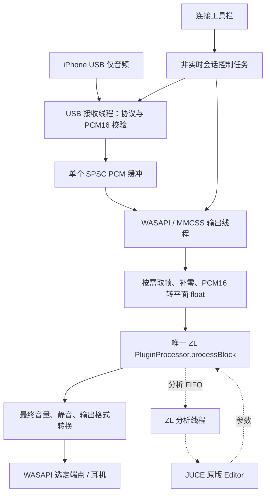

# ZL 原版界面 + iPhone USB 输入：集成设计与实施计划

> 历史记录：WPF 前端及其发布脚本现已移除；下文保留当时的设计或验收依据。当前入口见 [README](../README.md)。

分析日期：2026-09-24。实施更新：已构建自定义 Standalone、拆分共用后端、接入原版 ZL Processor/Editor，完成 DSP 回归和约 60 秒静音 USB 短测。
实际文件、完成范围和限制见[集成验收记录](zl-bridge-validation.zh-CN.md)，运行见[使用与构建](zl-bridge-running.zh-CN.md)。
下文保留设计时的分析与分阶段判据；其中“尚未编译/依赖未就绪”的描述是分析时状态，以本段及验收记录为准。

采用 **ZLCompressor 的 Processor、Editor、参数和分析器，加上自定义 JUCE Standalone 应用层**。
现有 iOSAudioBridge 提供 USB 音频接收、缓冲、WASAPI 输出和安全释放能力。
手机音频直接进入 ZL 的主输入总线，在同一进程中完成处理，无 VST Host、虚拟声卡或回环采集。

这是第二阶段的技术路线调整：主产品 UI 从 .NET/WPF 改为 C++/JUCE，以复用原版 ZL 界面。
第一阶段 WPF、C ABI 和当前发布包继续保留，作为回归基线；新产品不要求经 P/Invoke 搬运音频。
本文件取代[原分析文档](upstream-analysis-and-mvp-plan.zh-CN.md)中第二阶段“仅移植 DSP 子集、WPF 重做界面”的安排。
原文第一阶段协议、来源和验收记录仍有效。

## 1. 分析依据与明确边界

| 来源 | 固定版本 / 证据 |
|---|---|
| 当前音频后端 | `src/AudioCore/`；包含手机暂停恢复、快速且受保护的 USB 释放、恢复缓冲修复 |
| 当前二进制基线 | `test-results/2026-09-24-094655-stability/manifest.json` 中六个文件的 SHA-256 |
| ZLCompressor | `0e19ffcf3dcf7304ca2f650cd28267959bd40a21` |
| ZL 固定 JUCE 子模块 | `74c3b9a218f8552c7f33e176755d9020adcdb384`，仓库 `ZL-Audio/JUCE` |
| ZL 固定 Highway 子模块 | `2607d3b5b0113992fe84d3848859eae13b3b52c1` |
| ZL 固定 zldsp_fft 子模块 | `b741fb7ac6ecdb9ea935730aa34fa89602f3e52f` |

已阅读 ZL 的 Processor、Editor、DSP 控制器、参数定义、分析器、界面线程、预设读写、资源和 Windows CI。
已读取固定 JUCE commit 的 Standalone 启动源码、StandalonePluginHolder、CMake 辅助脚本及实际许可证。
研究目录为 `.research/ZLCompressor` 和 `.research/juce-pinned-review`，不能作为正式构建所依赖的隐式路径。
本轮仅补齐研究材料和文档，没有初始化完整 JUCE/Highway/FFT 构建依赖，没有编译 ZL。

目前可确认的是**源码接口与架构可行**，尚不能声称新程序已经保留全部界面行为、无实时分配或达到目标延迟。
已完成的真机证据是[约 15 分钟静音稳定性测试](stability-validation.zh-CN.md)：
无 USB 断连，42,593 个音频包，视频为 0，丢帧为 0，**欠载 1 次**。
集成后必须重新验证，不能继承为“压缩版本稳定通过”。

## 2. 为何能保留原版可视化

ZL 上游的 `CMakeLists.txt` 已列出 `Standalone` 构建格式。
`PluginProcessor` 提供 `prepareToPlay()`、浮点 `processBlock()` 和 `createEditor()`；
`PluginEditor` 直接持有同一个 Processor 的引用，并把它交给各个面板。

参数路径与显示路径分别为：


保留 `source/gui`、`source/panel`、`source/state`、`source/chore`、`source/zlp`、
`source/dsp`、Processor/Editor 和 `assets`，才能保留完整依赖链。
仅复制 `PluginEditor.cpp` 或压缩算法文件不够。

原版 `CurvePanel` 自带低优先级分析线程；`MagAnalyzerPanel` 从处理器的分析 FIFO 取数据，
Editor 可见性控制是否启用幅度分析。FIFO 满时 sender 只写可用空间或跳过，不能反过来阻塞 USB。
保留界面关闭/最小化时的分析开关逻辑，并验证恢复显示不会停止声音。

禁止为了显示再创建第二个 Processor；它会显示另一份参数和分析数据。
USB 状态栏读取我们自己的统计快照，不再增加一个消费者直接读取 ZL 的同一个 SPSC 分析 FIFO。
需要共享分析结果时从原接收端派生快照或使用独立统计通道。

## 3. Standalone 入口的选择

选择“**上游 Standalone 目标 + 自定义应用类和窗口**”，不使用默认 `StandalonePluginHolder` 驱动音频。

固定 JUCE 版本的 `juce_audio_plugin_client_Standalone.cpp` 已提供
`JUCE_USE_CUSTOM_PLUGIN_STANDALONE_APP` 分支；自定义分支请求全局 `juce_CreateApplication()` 工厂。
默认 `StandalonePluginHolder` 构造过程会打开 `AudioDeviceManager` 并启动播放，
因此不能为了拿到编辑器而创建它，再另外启动 WASAPI。

实施要点：

1. 只构建 `ZLCompressor_Standalone`，关闭安装到系统插件目录的构建后复制。
2. 仅对 Standalone 目标设置自定义应用宏，加入 `BridgeApplication.cpp`。
3. 提供固定版本要求的应用工厂，沿用 JUCE 的入口；不能又用 `START_JUCE_APPLICATION` 生成第二个入口。
   若选择完全自定义入口，须同时处理 `JUCE_USE_CUSTOM_PLUGIN_STANDALONE_ENTRYPOINT`；首版不采用该分支。
4. 应用持有唯一 Processor，并通过固定版本的 Standalone 工厂上下文创建，确保 wrapper 类型正确。
   工厂辅助函数的 include / 链接以第一轮编译验证为准，不通过默认 Holder 间接创建。
5. 在 JUCE 消息线程创建 Editor，将其放入自定义窗口内容组件；外围增加连接与输出工具栏、状态栏。
6. 不创建 `AudioProcessorPlayer` 的默认设备回调，不打开 Windows 麦克风输入。
   本项目直接驱动 `processBlock()`，承担初始化、生命周期、参数状态和延迟报告等必要工作。

参考：[固定 JUCE Standalone 入口](https://github.com/ZL-Audio/JUCE/blob/74c3b9a218f8552c7f33e176755d9020adcdb384/modules/juce_audio_plugin_client/juce_audio_plugin_client_Standalone.cpp)、
[固定 Holder 实现](https://github.com/ZL-Audio/JUCE/blob/74c3b9a218f8552c7f33e176755d9020adcdb384/modules/juce_audio_plugin_client/Standalone/juce_StandaloneFilterWindow.h)。

## 4. 数据流与线程归属



| 执行环境 | 职责 | 不应执行 |
|---|---|---|
| JUCE 消息线程 | 原编辑器、设备选择、状态刷新、参数手势 | USB 等待、join、WASAPI 渲染 |
| 会话控制任务 | 串行启动/停止、配置、重建输出、保存状态协调 | 与正在执行的 processBlock 并发 prepare/销毁 |
| USB 线程 | bulk 收包、协议回复、PCM 校验、单生产者入队 | DSP、绘图、等待 UI |
| WASAPI MMCSS 线程 | 单消费者取帧、DSP、最终输出、轻量统计 | USB 控制、文件 I/O、动态扩容、UI 锁 |
| ZL 分析线程 | 原版幅度、频谱等分析 | 驱动音频播放或改变 USB 会话 |

WASAPI 时钟决定消费速度；USB packet 大小不等于处理块大小。
保留一个音频队列，格式转换和 DSP 使用预分配暂存区，不额外增加“处理线程 + 第二条音频队列”。

## 5. 当前后端如何拆分

当前 `AudioSession` 直接持有 `WasapiOutput`，接收循环直接调用 `output_.enqueue()`、
`source_paused()`、`failed()`；环形缓冲位于 `WasapiOutput` 内部。
现有 C ABI 只提供启动、停止、状态和音量，没有外部 PCM 拉取接口。

建议在现有源代码上抽出下列边界，保持一个共同实现，避免维护两份 USB 协议代码：

| 拟新增模块 | 职责 |
|---|---|
| `UsbAudioSource` | 设备租约、激活、握手、PCM 校验、暂停、USB 释放；不认识 JUCE 或具体输出类 |
| `PcmPipe` | 持有 SPSC 队列、packet 最大帧数、最后到包时间、source pause 和会话代次 |
| `AudioEngine` | 唯一会话控制者，组合 Source、Pipe、Output 和处理器；保留初始化先于 USB 变更的顺序 |
| `IBlockProcessor` | 非实时 prepare/release 与实时平面 float 处理契约，不暴露 JUCE 类型 |
| `ZlProcessorAdapter` | 持有对唯一 ZL Processor 的有效引用，完成格式、总线、块长、参数策略适配 |
| `PassthroughProcessor` | WPF/AudioProbe 回归用直通实现；保留无 DSP 的对照能力 |

Source 向 Pipe 写入；Output 从 Pipe 读取。Source 不再检查 `WasapiOutput::failed()`，
由 Engine 接收输出错误后请求 Source 正常停止，并等待原有释放流程完成。
失败通知使用原子状态/有界命令，不让音频线程直接调用同步 stop。

拟定内部接口约束（不是已实现 API）：

```text
prepare(sampleRate, maxBlockFrames)   非实时、处理停止后；可分配
process(left, right, frameCount)     原位 float，0 < frameCount <= maxBlockFrames
release()                           停止并等待最后一次 process 返回后
snapshot()                          原子计数/固定大小快照
```

适配器捕获异常并通过非阻塞状态报告错误，失败块输出静音；仅标记 `noexcept` 不足以防止终止进程。
同一个 Pipe 始终保持单生产者/单消费者。reset/clear 只在双方退出或受控暂停后执行，
不能从 UI 直接清空索引；换会话更新代次，迟到命令不得作用于下一次连接。

新 Standalone 首选静态链接重构后的后端与 ZL，共用编译器和运行库；
现有 `AudioCore.dll` 仍由同一后端源码构建，给 WPF 和 AudioProbe 使用。
首版不设计跨 DLL 传递 `juce::AudioBuffer`、C++ 对象所有权或回调的 ABI。
若将来必须动态加载，再单独制定带版本号的 C 接口。

## 6. 主输入、格式与输出

### 总线初始化

ZL 构造时启用 `Input` stereo、`Aux` stereo 和 `Output` stereo，默认并非只有两条输入通道。
首版明确设置 Main Input = Stereo、Aux = Disabled、Main Output = Stereo，检查布局设置返回值，
然后再准备处理。对应上游 `kMain2Aux0` 分支从主音频派生内部侧链。

主音频必须进入 Input；Aux 是外部侧链，不能把手机声音只送入 Aux。
首版禁用外部侧链控件并显示“未提供外部侧链”；从预设导入 `external_side=true` 时也要规范化，
避免界面显示外部侧链已启用、实际却仍使用内部主音频。

### PCM 适配

- 手机侧维持 48 kHz、signed little-endian packed PCM16、Stereo；不匹配时明确报错。
- 交错 `[L0,R0,L1,R1]` 转为两个连续 float 通道，数值除以 32768；不做单声道混合。
- DSP 工作采样率固定 48 kHz、single precision；侧链内部 double 由 ZL 自己处理。
- 先设置总线、精度、处理采样率/块大小和 realtime 状态，再调用 `prepareToPlay()`。
  手动调用 prepare 不代替 JUCE 基类播放配置设置。
- 预分配每通道 4096 帧的处理暂存区，预先构造不拥有数据的 AudioBuffer 视图和空 MidiBuffer。
  WASAPI 请求超过上限时在同一次填充内分块调用，不为凑满 4096 帧等待新音频。
- 明确验证短块、非 2 的幂块长和尾块；实际需要处理多少帧，就只处理多少帧。
  不通过修改 AudioBuffer 容量在实时线程分配，不处理暂存区上一块遗留的数据。

### WASAPI 策略

第一轮继续使用现有 48 kHz PCM16 的共享事件驱动输出及已有自动格式转换后备路径。
在 CPU 暂存区完成 ZL 和格式转换后，再取得 WASAPI 输出缓冲并拷贝提交；
避免拿着端点缓冲执行非必要工作。DSP 输出转 PCM16 前做有限值检查与饱和转换，统计剪裁。

最终主音量/静音位于 ZL 之后，因此静音测试时原版输入、输出、增益衰减可视化仍能工作。
保留 ZL 自己的计量语义：默认监听功能关闭时，其输出分析位于压缩/Makeup 后、桥接主音量前；
源码中的 Delta、侧链监听或 EQ Solo 可能在分析取样之后改变最终声音。
桥接状态栏必须在整个 Processor 返回并应用主音量后，另计“设备输出电平”，不能直接复用原表读数。

后续再做 float32 客户端输出，以减少重新量化；不要在第一轮同时更换 WASAPI 格式和调度策略。
共享模式客户端格式与 DAC 硬件混音格式不必相同；必须报告是否发生系统格式转换。
pureaural 的可用格式/独占周期要实测，不能按型号预设。

## 7. 生命周期、暂停与错误

### 应用与会话

应用启动时创建 Processor，设置固定布局与 48 kHz 配置，prepare 并执行合成零块预热，
使分析 FIFO、参数延迟更新和工作缓冲就绪后，再创建会启动分析线程的 Editor。
设备尚未连接时也能显示编辑器；不能把“prepare 成功”显示为“USB 已连接”。

点击开始后，控制任务完成输出初始化、处理状态重置/预热和配置核验，再激活 USB。
启动失败按已经取得的资源逐步回收。队列达到既有启动水位才开始消耗真实音频。

点击停止/关闭时：停止接受重复命令 → 禁止新 DSP 调用并等待输出线程退出 →
请求 USB 源停止 → 执行协议收尾、关闭流句柄、独立 helper 恢复及 PnP 确认 → 完成状态更新。
整个等待不占用 JUCE 消息线程。退出应用时还须先销毁 Editor 并等待它的分析线程结束，
最后释放 Processor；任何音频或分析线程都不能再引用已销毁对象。
自定义应用需要延迟真正 quit，不能在 `systemRequestedQuit()` 中发起异步清理后立即退出。

`PluginProcessor::releaseResources()` 在当前上游为空，继承的 reset 也不能被当作已实现的 DSP 清零。
需要重置时，在处理停止且分析访问受协调的条件下重新 prepare/预热；
参数保留、历史状态清理和恢复时增益淡入必须明确分开。

### 手机暂停

- 保留本地主动停止标志与手机 SYNC STOP 的区分：普通播放暂停进入 Paused，USB 不释放。
- 暂停尾部仍可排空已有 PCM；队列耗尽后按输出时钟向 DSP 喂零，使包络自然释放、仪表回落。
- 恢复时保留现有 `ResumeBufferGate`，累计启动水位后继续取 PCM，最终输出增益平滑恢复。
- 已知暂停/恢复准备不算欠载；运行中真正供给不足计入 `underruns` 与 `missing_frames`。
- 对暂停期间 DSP 残留延迟尾音要有明确行为：首版低延迟模式为 0 lookahead / oversampling Off；
  若后续允许有延迟模式，则验证尾音排空和最终静音规则，不能只给输入补零就声称立即静音。

### 输出错误、拔线与切换端点

输出失败时 Engine 请求 Source 按既有安全路径清理，不自动切到另一实体设备出声。
首版切换端点采取“停止本会话 → 完整释放 → 重建 → 手动开始”；不同时加入无缝热切换。
拔线保留原有物理存在性检查，错误不被当作手机暂停。自动重连是后续独立功能。

受保护的 USB 释放顺序和单次控制请求策略不因改成 JUCE 而改写，
同设备租约名称也不改，确保旧 WPF 与新程序不能同时占用同一 iPhone。

## 8. 参数、预设与低延迟约束

原版 APVTS 是唯一参数来源；外层快捷预设也通过它更新，并使用原有参数转换/通知，
不能把 dB 或毫秒原值直接当成 0–1 归一化值传入，也不能绕过 Attach 只修改 DSP。

| 用户参数 | 源码参数 ID | 上游范围 | 首轮 PUBG 调试起点（非已验收预设） |
|---|---|---|---|
| Threshold | `threshold` | -100 至 0 dB | -18 dB |
| Ratio | `ratio` | 1 至 100 | 4:1 |
| Attack | `attack` | 0 至 1000 ms | 2 ms |
| Release | `release` | 0 至 5000 ms | 100 ms |
| Knee | `knee_width` | 0 至 32 dB | 6 dB |
| Makeup Gain | `makeup` | -30 至 +30 dB | 0 dB |

这些数值用于开始调试，需要真实游戏素材和试听调整；不是 ZL 原版默认值。
普通向下压缩不能识别“枪声”与“脚步”，只按检测信号电平工作；
零 lookahead 和非零 Attack 也不能保证完全截住瞬态峰值。保留脚步表现需要结合阈值、释放和音量验收。

默认低延迟配置：Compress / Clean，lookahead = 0，oversample = Off，RMS = Off，
内部侧链，Left Right Max、Stereo Link = 100%、左右 Wet 一致，Side Swap / Side Out / Delta / EQ Solo 关闭，
Makeup = 0，Clipper Drive = 0，自动响度匹配关闭。
原版默认 Stereo Mode 为 Mid Side、Link 为 0，不能直接沿用并声称保证游戏定位。
“完整链接保持左右共同增益”仍须用左右不对称信号、脉冲和实际定位验证。

### 参数变化不等于所有路径已经实时安全

源码中 `CompressController::prepareBuffer()` 的过采样变化会重新准备 tracker、调整 hold capacity；
底层 `CircularBuffer::setCapacity()` 调用 vector resize。prepare 虽做过最大容量预留，
仍不能仅凭这一点承诺任何设置变化都无分配或无耗时尖峰。
延迟变化还通过 AsyncUpdater 通知 Processor，消息线程工作不应计入渲染线程日志。

首版策略：

1. 六项核心参数保持实时调整，逐项检查更新路径并做音频线程分配与耗时测试。
2. 保留原版过采样功能的编译支持，但游戏低延迟模式锁定为 Off，lookahead 锁定 0；
   界面明确显示限制，不静默忽略用户修改。不先删除这些参数或改变参数 ID。
3. 涉及过采样、总线、采样率、完整状态恢复的变更通过控制任务进行受控停处理、重新准备，
   不在 processBlock 内销毁、重新分配或等待消息线程。首版不提供运行中开启高延迟模式。
4. 原版预设浏览器直接调用 `setStateInformation()`；这是必须调整的接入点。
   导入先校验并规范化低延迟约束，再经控制流程应用，不能只约束工具栏而漏掉预设加载。
5. 状态读取/复制和 XML/文件操作不放到音频线程；运行时状态恢复要覆盖所有入口。
   文件读取可在后台进行，参数树/Editor 相关应用在消息线程执行，控制任务先取得处理暂停确认；
   prepare/release 在无并发音频调用、分析访问受协调时完成，结果再交回消息线程。
   不用一个跨 UI 和音频的普通互斥锁来“保护一切”，音频线程也不等待 MessageManagerLock。

预设、设置与 UI 状态放在本产品独立命名空间，避免覆盖用户安装的原版 ZL 文件。
上游 `property.hpp`、`preset_browser.cpp` 和 UI 设置路径需要统一审查；
重命名产品后验证旧路径迁移不会自动改写原版目录。

## 9. 延迟与本轮欠载的后续处理

分开报告：软件 PCM 队列时间、WASAPI 已提交排队时间、DSP 报告延迟、驱动流延迟。
软件可见估计采用 `queue / 48000 + padding / 48000 + DSP_samples / 48000`，
标注采样瞬时性及未测量的 iPhone/USB/DAC 部分；驱动流延迟单列，不盲目重复相加。
仅作离线时间对齐的插件延迟报告不能消除实时链路已经产生的 lookahead 延迟。

保留默认 startup=3072、high_water=4096、capacity=8192 做集成对照；不把容量当延迟。
3072 帧约 64 ms 是启动储备目标，既有实际阈值还受端点容量与 packet 大小影响，
不代表稳态队列恒定为 64 ms，也不能宣称整条链路只有 64 ms。

现有 15 分钟测试在 `t=762` 首次出现 1 次欠载，未断连；这轮 AudioProbe 未记录缺失帧细节。
实施前先增加低开销诊断：

- `missing_frames`、欠载首次/最近单调时钟、每个统计窗口的队列最小/最大值。
- USB 到包最大间隔、接收帧总数、输出需求帧总数、时钟时间戳。
- processBlock 耗时分布/最大值、输出填充耗时、迟到唤醒、剪裁及非有限值计数。
- 实时线程只更新原子计数或写有界遥测队列；后台定期落盘。

先用连续有音频区间判断水位是否有长期斜率；排除暂停、启动和裁剪后再评估采集/播放时钟差。
若确有漂移，再引入共享左右相位的自适应重采样与目标水位控制，不定期粗暴丢/补单个样本。
WASAPI 共享格式转换不等于已经补偿 iPhone 与 DAC 两个时钟域。
USB 抖动、系统调度和时钟差尚未归因，不在文档中把任何一个写成已确认根因。

## 10. 构建与依赖落地

| 依赖/问题 | 分析结论与动作 |
|---|---|
| 编译器 | ZL Windows CI 使用 clang-cl；当前后端使用 MSVC cl。新目标优先 clang-cl + MSVC STL/SDK，全部 C++ 源码统一重编译 |
| SIMD | 上游 CMake 的 `-march` 等选项面向 Clang，不能直接交给 cl。首版 SSE2，AVX2 另设可选包 |
| C++ / CRT | C++20、x64、Release、统一 `/MT`；避免混用不同运行库/编译选项的静态对象 |
| JUCE | 使用 ZL 固定 fork/commit，不能擅换系统 JUCE 或拉子模块 master 最新版 |
| Highway / FFT | 按固定 gitlink 递归补齐，再记录其二级依赖；当前子模块目录为空，不是可构建状态 |
| 资源 | 完整 assets（字体、图标、原预设等）通过 BinaryData 编译；packaging 图标路径必须存在 |
| Intel IPP | 仓库有可选 CMake 片段和 `#if (MSVC)` 包含，当前主 CMake 未见引用该 IPP 片段，不能误报为已确定硬依赖；核对实际预处理宏与链接结果 |
| USB 运行时 | 继续打包 x64 libusb0.dll 和 AudioBridge.UsbRestore.exe，精确放在主程序目录；保持现有驱动安装方式 |
| 构建副作用 | `ZL_JUCE_COPY_PLUGIN=OFF`，仅 Standalone，不安装 VST/LV2、不升级系统驱动 |
| 工具链现状 | 本次 PATH 未找到 clang-cl；需实现阶段补齐并固定版本，当前不宣称能直接执行新构建 |
| 版本计算 | 上游 GitVersion 的 git 命令缺少明确工作目录。嵌入外层项目时应绑定 ZL 源目录/固定版本文件，避免读到外层仓库版本 |

正式源码放入有清单和许可证的 `third_party/ZLCompressor/` 或独立 vendor 源目录，
保留固定上游原始快照和最小补丁；不在 `.research` 中开发发布版本。
对现有 CMake 中全局编译选项做目标级隔离，ZL 的全局 SIMD flags 不应影响辅助进程。
新构建目录为 `build/zl-bridge`，发布目录为 `dist/ZLUsbAudioBridge`，不覆盖现有 `dist/iOSAudioBridge`。

原版构建验证的拟定 CMake 选项为：`CMAKE_C_COMPILER=clang-cl`、`CMAKE_CXX_COMPILER=clang-cl`、
`ZL_JUCE_FORMATS=Standalone`、`ZL_JUCE_COPY_PLUGIN=OFF`、`ZL_HWY_STATIC_TARGET=SSE2`。
完整依赖就绪后再落实可执行脚本；这些选项不是已验证的一键构建命令。

### 许可证与来源材料

当前桥接来源是 GPL-3.0；ZL 主许可证及源码头是 AGPL-3.0；固定 JUCE 子模块提供 AGPLv3/商业双许可路径；
Highway 附带 Apache-2.0 许可。保留各文件原始声明，不把全部来源统一改写成 GPL。
固定 JUCE 的实际 LICENSE.md 引用 JUCE 9，而 ZL 顶层复制的 `licenses/JUCE_LICENSE.md` 仍引用 JUCE 8，
发布时以实际集成子模块的许可证为准并补齐 notices，不能仅复制那份旧文件。

开源集成按 AGPL 路线准备组合程序、修改源码和构建依赖的交付材料；
原 GPL 部分、字体/图标、FFT 及其依赖分别保留许可证。
实现阶段读取完整子模块和资源许可清单后更新 THIRD_PARTY_NOTICES，当前文档不把尚未读到的 FFT/资源许可视为已审核完成。
来源：[ZL 固定 LICENSE](https://github.com/ZL-Audio/ZLCompressor/blob/0e19ffcf3dcf7304ca2f650cd28267959bd40a21/LICENSE.md)、
[JUCE 固定 LICENSE](https://github.com/ZL-Audio/JUCE/blob/74c3b9a218f8552c7f33e176755d9020adcdb384/LICENSE.md)。

## 11. 文件改造清单与项目布局

| 当前文件/目录 | 后续处理 |
|---|---|
| `src/AudioCore/src/Protocol/`、`Media/`、`Transport/` | 共用原实现；不重写已经验证的仅音频协议 |
| `Session/AudioSession.cpp/.h` | 分离 USB Source 与 Engine；保留 C ABI 门面和现有行为 |
| `Session/UsbRestore.inl`、`Capture/*Policy.h` | 移到/归属 USB 生命周期模块，保持策略与回归覆盖 |
| `Wasapi/WasapiOutput.cpp/.h` | 队列外置、接入块处理器、预分配暂存区、补充诊断 |
| `Buffer/SpscPcmRing.h`、`ResumeBufferGate.h` | 共用并维持既有单生产者/消费者与恢复规则 |
| `AudioCore.cpp`、`include/AudioCore.h` | 保持第一阶段 ABI；新增遥测若跨 ABI 则另立带尺寸/版本的接口，不静默改结构体大小 |
| `src/AudioBridge.UsbRestore/` | 同源构建和打包，目录定位方式不变 |
| ZL `PluginProcessor` / `PluginEditor` | 尽量保留；新增低延迟策略和状态应用入口，Editor 布局主体不重画 |
| ZL `panel/preset_browser` / `state` | 接入受控预设加载、独立设置路径和受限参数提示 |
| ZL CMake / GitVersion | 自定义 Standalone 入口、构建选项隔离、版本和产品命名 |
| `tools/AudioProbe`、`tests/` | 保留旧功能；补充新处理链、遥测和生命周期回归 |

拟定新增结构：

```text
src/AudioCore/src/
  Capture/UsbAudioSource.*
  Buffer/PcmPipe.*
  Engine/AudioEngine.*
  Processing/IBlockProcessor.h
  Processing/PassthroughProcessor.*
src/ZLUsbAudioBridge/
  BridgeApplication.cpp
  BridgeWindow.*
  BridgeToolbar.*
  BridgeStatusPanel.*
  ZlProcessorAdapter.*
  LowLatencyPolicy.*
  BridgeSettings.*
third_party/ZLCompressor/        # 固定快照 + 补丁清单
scripts/Build-ZLBridge.ps1       # 实现阶段新增
tests/ZLBridgeTests/            # 实现阶段新增
```

路径为计划，并不表示文件已经存在。实际拆分以不引入循环依赖、保留基线回归为准。

## 12. 分阶段实施与完成判据

| 阶段 | 交付物 | 进入下一阶段的条件 |
|---|---|---|
| A：依赖与界面 | 固定源码/工具链清单；自定义 Standalone 窗口显示原编辑器；合成输入 | 原图形资源、参数、曲线、预设可用；无默认麦克风/音频设备回调；单 Processor |
| B：后端拆分与诊断 | Source/Pipe/Engine/Output 分离；旧 WPF/Probe 可运行；新增 missing_frames 等 | 原 Native/ABI/暂停恢复/释放回归通过；旧功能无退化；获得可比较的欠载基线 |
| C：USB 旁路接通 | USB → float 适配 → ZL 旁路 → WASAPI；原界面可见 | 48k/16/stereo、零视频、左右正确、暂停恢复保持 USB；静音输出有效 |
| D：压缩和实时参数 | 六项实时参数、游戏低延迟配置、增益衰减可视化、预设策略 | 合成信号压缩曲线/动态响应正确；六项快速拖动无新增欠载/分配；导入约束不被绕过 |
| E：稳定与设备验收 | 15 分钟对照、30 分钟 PUBG、至少 2 小时持续运行、目标 DAC 验证报告 | 无非预期断连，目标为无非预期欠载/丢帧；未达标则保留失败记录并定位后复测 |

阶段 A 的默认模板不得自动打开物理音频输入输出；需要音频驱动验证时采用合成静音和现有 WASAPI。
真机测试继续沿用用户“只做静音测试”的选择；有声试听不在当前授权范围内。
不因文档完成自动启动新的长时间真机测试。

### 必须覆盖的测试

- **数值与格式**：PCM16 极值、负数、左右通道不同信号、转换量化误差、NaN/Inf、越界剪裁计数。
- **处理尺寸**：1/127/480/1024/4096 帧、超过上限分块、零帧跳过；不能越界或使用旧块尾部。
- **旁路区别**：适配层直通作为数值对照；ZL `processBlockBypassed`/comp_on 的分析、侧链监听和延迟语义分别验证，
  不把开启 Side Out/Solo 的“压缩旁路”当成原始音频直通。
- **DSP**：确定性阶跃/脉冲、稳态曲线、Attack/Release、Knee、Makeup；左右不对称输入下声道顺序与共同增益。
- **实时性**：音频线程分配检测、回调耗时与期限、六项参数快速修改、窗口缩放/最小化/频谱开关。
  调试检测与发布性能测试分开记录，不能把检测器开销当成正式版本性能。
- **生命周期**：重复开始/停止、连接中关闭、DSP prepare 失败、输出失败、手机暂停≥10秒后恢复、拔线、端点移除。
- **数据与 UI 一致**：UI 与处理器同实例；静音不阻止 DSP 分析；重载预设同时更新参数与曲线，不能只改 UI。
- **状态和文件**：错误预设、含高延迟配置预设、原版预设导入、重启恢复；独立目录无原版状态污染。
- **长期运行**：记录每秒源帧、输出帧、水位、欠载/缺失帧、延迟估计、内存/句柄、UI 可见状态与输出设备。
- **退出**：流句柄先关闭、helper 单次恢复、确认正常配置，Processor/Editor 不被工作线程悬空引用。

退出码 0 只代表程序完成，验收要检查全部指标。现有 1 次欠载不能在集成时清零隐藏；
新旧构建、相同设备和配置的报告必须分别保留。独占模式、自动连接和开机启动安排在上述链路稳定之后。

## 13. 尚待实现验证的事项

1. 完整子模块及二级依赖、编译器版本和最终链接兼容性；当前尚无 ZL 构建成功证据。
2. 自定义工厂/目标宏与资源生成的实际编译结果，以及 Editor 的窗口缩放和线程关闭行为。
3. 参数更新、状态加载和所有分析器路径的实时性；本轮只完成重点源码检查，未做动态分配测试。
4. 零 lookahead/oversampling 下的实际处理延迟和开销，不能仅以参数值为零推断端到端零延迟。
5. 现有欠载的根因、目标 DAC 的格式与稳定周期，以及长时间游戏下的双时钟行为。

这些项有对应实施阶段和验收方法，不需要先更换原有驱动或丢弃已验证的 USB 后端。

## 源码定位索引

下列 ZL 路径均相对固定上游根目录，可通过固定 commit 链接定位：
[ZL 源码树](https://github.com/ZL-Audio/ZLCompressor/tree/0e19ffcf3dcf7304ca2f650cd28267959bd40a21)。

| 结论 | 主要源码 |
|---|---|
| 独立目标、Clang/SIMD、资源 | `CMakeLists.txt`、`.github/workflows/cmake_release.yml`、`cmake-includes/Assets.cmake` |
| 默认主/侧链总线、float 入口 | `source/PluginProcessor.cpp`：构造、prepareToPlay、kMain2Aux0、processBlock |
| 原版 Editor 与 Processor 关联 | `source/PluginEditor.cpp`、`source/panel/main_panel.cpp` |
| 参数 ID、范围、默认值 | `source/zlp/zlp_definitions.hpp`、`compress_attach.cpp` |
| 过采样、lookahead、延迟报告 | `source/zlp/compress_controller.cpp`：prepare / prepareBuffer / handleAsyncUpdate |
| 可能扩容的更新路径 | `source/dsp/container/circular_buffer.hpp`、`compressor/tracker/rms_tracker.hpp` |
| 分析生产者与 UI 消费 | `source/dsp/analyzer/analyzer_base/analyzer_sender_base.hpp`、`panel/curve_panel/` |
| 预设直接恢复、状态目录 | `source/panel/preset_browser/preset_browser.cpp`、`source/state/property.hpp`、Processor 状态方法 |

JUCE 公共生命周期语义参考 [AudioProcessor 文档](https://docs.juce.com/master/classjuce_1_1AudioProcessor.html)；
实际实现以固定子模块源码为准，避免把在线 master 文档中的新增 API 当作当前可用接口。
